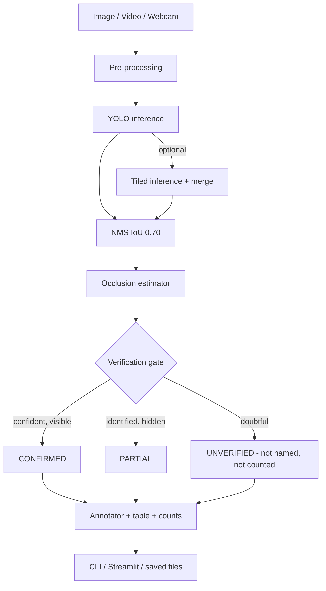

# Project Report

## Title
Occlusion-Aware Detection and Localisation of Products on Warehouse Shelves Using YOLO, with Verification-Gated Reporting

## Abstract
This project builds a computer vision prototype that detects and locates individual products on a warehouse shelf,
including products placed close together or partly hidden behind others. It uses a YOLO object detector with
settings tuned for dense scenes (high NMS IoU, enlarged input, optional sliced inference) and adds a verification
layer that classifies every detection as CONFIRMED, PARTIAL or UNVERIFIED using confidence and an estimated
occlusion fraction. Only verified detections are named and counted, so the system avoids confidently reporting objects
it cannot identify. A command-line tool and a Streamlit interface are provided. A pretrained COCO model is used for the
initial demonstration; custom training is described for warehouse-specific products. The decision logic has been unit
tested; detection accuracy on real shelf images has not yet been measured.

## Problem statement
Design a computer vision system that detects and locates products on a warehouse shelf, even when several products are
placed close together. Additional constraint: some products are partially hidden, and the system must not confidently
report objects it cannot identify.

## Existing system and limitations
- Manual counting / barcode scanning: slow, labour-intensive, error-prone, needs line of sight to each barcode.
- Basic detectors with default settings: low NMS thresholds delete real neighbours; default 640 px input loses small items.
- Typical detectors output every box above one threshold with a class name, so a hidden or unknown object can be reported
  as a confident but wrong product.
- Pretrained models know only generic classes (COCO: 80), not brands or SKUs.

## Proposed system
YOLO detection -> NMS tuned for crowded shelves -> occlusion estimation -> verification gate -> annotated output and table.
Key idea: separate "something is here" (a box) from "I know what it is" (a verified label). Unverified boxes are shown
but unnamed and uncounted.

## System architecture

## Algorithm and workflow
1. Load and validate the image (or read frames).
2. Run YOLO at `imgsz` (default 960) with a low confidence floor (0.15) and NMS IoU 0.70. Optionally add overlapping
   640 px tiles and merge with class-wise NMS.
3. Drop tiny boxes and (optionally) classes not relevant to the warehouse.
4. For each box compute: occlusion = share of the box covered by more-confident boxes; truncated = touches image border.
5. Assign status: conf < 0.35 -> UNVERIFIED; occlusion >= 0.80 -> UNVERIFIED; occluded/truncated and conf >= 0.35 -> PARTIAL;
   unoccluded and conf >= 0.50 -> CONFIRMED; else UNVERIFIED.
6. Assign IDs (most confident first), draw boxes (green/orange/red), print table, report counts, save output.

Concepts: **IoU** = overlap area / union area of two boxes. **NMS** keeps the highest-scoring box and removes boxes
whose IoU with it exceeds a threshold; low thresholds remove real neighbours, high thresholds keep duplicates.
**Confidence threshold** trades missed products against false claims. **Instance segmentation** gives pixel masks, so
visible area under occlusion can be measured exactly; it is more suitable for heavy overlap but costlier and needs mask labels.

## Hardware and software requirements
Hardware: any laptop with 8 GB RAM, CPU only (GPU optional, recommended only for training); webcam optional.
Software: Python 3.9-3.12, ultralytics, opencv-python, numpy, pandas, streamlit.

## Modules
1. Input module (image/video/webcam loading, validation)
2. Detection module (YOLO wrapper, tiling)
3. Occlusion and verification module
4. Visualisation module (annotation, tables)
5. Interface modules (CLI, Streamlit)
6. Training and evaluation modules (optional)

## Advantages
- Runs on CPU; simple, readable code.
- Neighbouring products kept separate via NMS tuning and larger input size.
- Honest output: uncertain objects are not named or counted.
- Configurable thresholds; optional custom training.

## Limitations
- Pretrained COCO cannot identify brands/SKUs; most warehouse items will be unverified until custom training.
- Occlusion is estimated from boxes and confidence (heuristic), not true depth.
- Confidence is not perfectly calibrated; thresholds must be tuned on real data.
- Tiling can produce duplicate/fragmented boxes at tile borders.
- Video IDs are per-frame, not tracked across frames.
- Identical items stacked deep may be uncountable from one camera view.

## Testing procedure and sample test cases
Automated (`python test_logic.py`, no model needed) - **actually run: 9/9 passed** in the development environment:

| # | Case | Expected |
|---|---|---|
| 1 | Clear object, conf 0.80 | CONFIRMED |
| 2 | Unoccluded, conf 0.40 | UNVERIFIED |
| 3 | conf 0.20 | UNVERIFIED |
| 4 | Neighbour covers 50% of a box | front CONFIRMED, hidden PARTIAL (50% hidden) |
| 5 | Box ~99% covered, conf 0.45 | UNVERIFIED |
| 6 | Box cut by image edge, conf 0.70 | PARTIAL |
| 7 | Touching, non-overlapping neighbours | both CONFIRMED |
| 8 | No detections | empty result |
| 9 | Unverified object | label shown as "unverified object" |

Manual (to do on real photos, record your own results): (a) sparse shelf, (b) tightly packed shelf, (c) partly hidden
items, (d) object type not in the model (must come out UNVERIFIED or absent, never confidently named), (e) dim light,
(f) video, (g) missing file / corrupt file / no internet error messages.

## Expected output and evaluation metrics
Expected (not yet measured): colour-coded boxes with ID, label, confidence; counts for confirmed/partial/unverified;
coordinate table. Pretrained model on non-COCO products: mostly unverified or wrong generic labels.

Metrics to measure on a labelled test set with `evaluate.py`: precision, recall, mAP@0.5, mAP@0.5:0.95, inference time.
Additional project-specific metrics: count error (|predicted - true|), and **false-assertion rate** (verified detections whose
label is wrong) - the key measure for the "do not claim what you cannot identify" constraint.

| Metric | Pretrained (COCO) | Custom model |
|---|---|---|
| Precision | *measure* | *measure* |
| Recall | *measure* | *measure* |
| mAP@0.5 | *measure* | *measure* |
| False-assertion rate | *measure* | *measure* |
| Inference time (CPU, ms) | *measure* | *measure* |

(No values are given because none have been measured yet.)

## Future enhancements
Instance segmentation for exact visible area; multi-frame tracking; calibrated confidence and an "unknown product"
class trained with hard negatives; SKU recognition via crop classifier or embeddings; barcode/OCR cross-checking;
inventory database integration; multi-camera views for depth; edge deployment (ONNX/OpenVINO).
